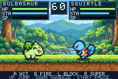

# Pokémon Battle Arena

**Pick your Pokémon. Read your rival. Earn your super.**

A native Game Boy Advance fan-made fighter by **Surenkh**.

[**Download the GBA game**](downloads/PokemonBattleArena.gba?raw=true) · [Checksum](downloads/SHA256SUMS.txt)

Version **0.5.0 — Fighter Depth & Practice**. Open the ROM in a GBA emulator such as mGBA. On GitHub's file page, use **Download raw file** if needed. No commercial ROM or BIOS is included. A dedicated GitHub Release has not been created.

Six fighter traits change movement, guard pressure, reach and counterattacks. A clean melee hit can lead into one projectile follow-up; Eevee can also follow with melee at close range. Follow-ups spend normal stamina and remain blockable. B on the title opens practice, with idle, blocking and attacking opponents, damage feedback and quick arena reset.

## Six fighters, six playstyles

| Fighter | Signature behavior | Attack visuals |
| --- | --- | --- |
| Pikachu | Quick Step advances grounded melee startup | Crackling lightning |
| Charmander | Ember Pressure drains more guard stamina | Flames and embers |
| Squirtle | Efficient guard impacts and stronger water pushback | Water pulses and splashes |
| Bulbasaur | Longer melee reach with a vine cue | Spinning leaves and vines |
| Eevee | Can follow a clean melee hit with A or B | Glowing stars |
| Meowth | Extra melee damage when catching attack recovery | Claw waves and scratches |

Normal projectiles and supers have four-frame animations. Muzzle flashes, hit effects, and blocked-hit effects match the attacker. Movement animations, momentum, stamina, CPU opponents, and charged supers remain part of the game. Supers bypass block and can be evaded with a jump or timed squeeze.

## Controls

| GBA button | Action |
| --- | --- |
| Left / Right | Move |
| Up | Jump |
| Down | Timed squeeze dodge |
| A | Melee |
| B | Fire |
| L held | Block |
| R | Super: 100 SP and 25 stamina |
| Start | Pause |
| Select on title/selector | Controls |
| B on title | Practice setup |
| R in either selector | Fighter guide |
| Select in practice setup | Cycle fighter / behavior / rival options |
| Select during practice | Reset arena, resources and practice statistics |

Emulator key bindings depend on your setup. Clean hits earn super power; blocks and misses do not. For a follow-up, tap B when FOLLOW B appears after a clean A hit. Eevee may use A when FOLLOW A/B appears; stay close enough for the second melee hit. One follow-up is allowed per attack sequence, and the defender can block it.

Practice uses the same combat rules, starts with full SP and freezes the timeout. Choose IDLE, BLOCK or ATTACK behavior and a different rival Pokémon. KOs automatically restart practice while retaining the best sequence; Select manually resets it. Start opens the normal pause menu.

## Build and development

The editable GBA Studio project, C++ runtime, engine sources/notices, required source assets, tools, and tests are included. See [BUILDING.md](docs/BUILDING.md), [test evidence](docs/FIGHTER_DEPTH_TEST_REPORT.md), [implementation decisions](docs/FIGHTER_DEPTH.md), [roadmap](docs/development/ROADMAP.md), and [Git workflow](CONTRIBUTING.md).

The v0.3.0 and v0.4.0 updates were merged through PRs #1 and #2. The v0.5.0 work uses `feat/fighter-depth`. Keep changes in feature branches and update the ROM and checksum together after validation. Compiler binaries are not bundled. Historical browser-preview exports and unused optional artwork from the original pack are omitted; native build inputs and their provenance are retained.

## Limits and feedback

Physical GBA hardware and non-Linux rebuilding have not been tested. There is one arena, no multiplayer, campaign, save system, or background music. For bugs, include version, emulator/device, fighters, reproduction steps, and expected versus actual behavior.

## Credits

Unofficial fan project, not affiliated with or endorsed by Nintendo, Game Freak, or The Pokémon Company. Pokémon belongs to its respective owners. Preserve the artwork credits in assets/source/ and the engine and third-party license notices in engine/.
