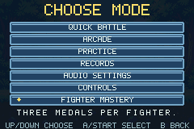
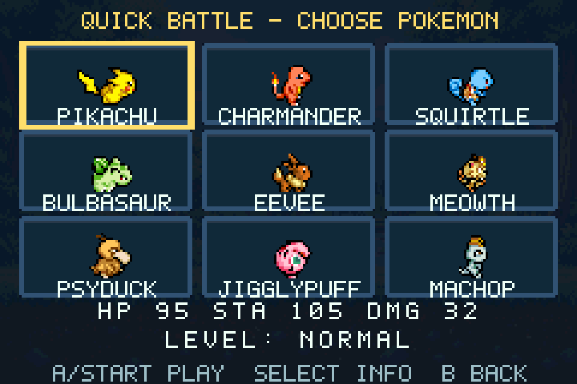
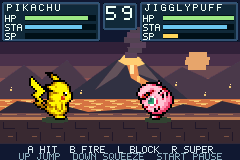
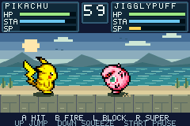
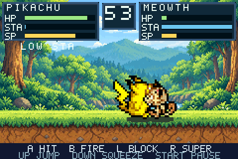

# Pokémon Battle Arena

**Pick your Pokémon. Read your rival. Earn your super.**

A native Game Boy Advance fan-made fighter by **Surenkh**.

[**Download the GBA game**](https://github.com/Surenkh/pokemon-battle-arena-gba/releases/latest/download/PokemonBattleArena.gba) · [Player ZIP](https://github.com/Surenkh/pokemon-battle-arena-gba/releases/latest) · [Checksums](https://github.com/Surenkh/pokemon-battle-arena-gba/releases/latest/download/SHA256SUMS.txt) · [Release history](https://github.com/Surenkh/pokemon-battle-arena-gba/releases)

Version **0.9.1 — Responsive Firing**. Open the ROM in a GBA emulator such as mGBA. The release includes the ROM, a player ZIP with controls/credits, checksums and source archives. No commercial ROM or BIOS is included. A [repository copy](downloads/PokemonBattleArena.gba?raw=true) is also available.

Press **A/Start on the title** to open the visible mode menu: **Quick Battle, Arcade, Practice, Records, Audio Settings, Controls and Fighter Mastery**. Choose a mode first, then select a Pokémon and difficulty or practice options. Menu selection uses the D-pad and A/Start, so entering Arcade does not require a shoulder button. The title displays **v0.9.1** and **9 fighters**.

**Psyduck, Jigglypuff and Machop** join the original six fighters, each with configured stats, a distinct trait, 13 runtime animation states, themed projectile/super/impact effects, combat sounds and a CPU style. Psyduck pushes rivals away with psychic attacks; Jigglypuff has lighter gravity and longer jumps; Machop drains extra guard stamina with melee. See [full fighter data](docs/NINE_FIGHTERS.md).

Arcade samples five unique opponents from the other eight fighters at the selected difficulty. It grants two continues and restores resources between fights. Clears, no-continue clears and fastest total battle times save separately for all 27 fighter/difficulty pairs. Saves from the earlier six-fighter v0.8 build migrate automatically.

The title and menus now play an original looping tune, with new navigation, countdown, pause, result and recall cues. Press **L** on the title or pause screen for independent **Music** and **Sound FX** controls. Both default to On with a moderate mix; choices save when you leave Audio Settings.

Normal fights end with a Poké Ball recalling the defeated Pokémon through an animated beam. The winner stays visible, and the ball closes before results. Tap A/Start after closing to continue sooner; practice keeps its quick reset.

CPU rivals now use fighter-specific spacing and attack preferences, varied tactical plans and stamina reserves. Easy leaves more openings; Normal mixes plans; Hard reacts and follows up more reliably. The AI reacts to delayed visible actions and remembers only a short history of repeated attacks.

Nine fighter traits change movement, guard pressure, reach and counterattacks. A clean melee hit can lead into one projectile follow-up; Eevee can also follow with melee at close range. Follow-ups spend normal stamina and remain blockable. B on the title opens practice, with idle, blocking and attacking opponents, damage feedback and quick arena reset.

Normal shots now show an immediate windup for Pikachu, Squirtle, Meowth, Psyduck and Machop. The firing cue appears by the second emulator frame after a sampled tap. See [response measurements](docs/RESPONSIVE_FIRING_TEST_REPORT.md).

## Three arenas and fighter mastery

Choose **Woodland, Volcanic or Shoreline** in Quick Battle or Practice. Quick
Battle has an Arena row below Level; Practice adds Arena as its fourth option.
Configure the options, return to the grid to choose any fighter, then A/Start
plays. Arcade rotates through all three arenas; retries preserve the current
stage. The arenas share the same floor, hitboxes and combat rules.

**Fighter Mastery** is a visible main-menu button. Each Pokémon has three cosmetic
medals: **10 damaging follow-up hits**, **5 successful super evasions**, and a
**no-continue Arcade clear** at any difficulty. Practice does not count. Roster
badges show earned medals, and Mastery/Records link with A. Progress saves at round
end, Rematch or leaving a fight. Both six- and nine-fighter v0.8 saves migrate;
existing no-continue records already count toward their medal.

## Nine fighters, nine playstyles

| Fighter | Signature behavior | Attack visuals |
| --- | --- | --- |
| Pikachu | Quick Step advances grounded melee startup | Crackling lightning |
| Charmander | Ember Pressure drains more guard stamina | Flames and embers |
| Squirtle | Efficient guard impacts and stronger water pushback | Water pulses and splashes |
| Bulbasaur | Longer melee reach with a vine cue | Spinning leaves and vines |
| Eevee | Can follow a clean melee hit with A or B | Glowing stars |
| Meowth | Extra melee damage when catching attack recovery | Claw waves and scratches |
| Psyduck | Mind Push gives strong projectile knockback | Psychic rings and pulses |
| Jigglypuff | Float Step lowers gravity and extends jumps | Musical notes and crescendos |
| Machop | Heavy Hands drains extra melee guard stamina | Fists and impact bursts |

Normal projectiles and supers have four-frame animations. Muzzle flashes, hit effects, and blocked-hit effects match the attacker. Movement animations, momentum, stamina, CPU opponents, and charged supers remain part of the game. Supers bypass block and can be evaded with a jump or timed squeeze.

[Watch the native music and recall preview](docs/media/sound-and-recall-native.mp4)

## Controls

| GBA control | Action |
| --- | --- |
| D-pad in menus | Select a mode button, Pokémon or option |
| A / Start in menus | Confirm / play |
| B in menus | Back |
| Select in Quick/Arcade selection | Fighter information |
| Select in Practice setup | Choose fighter / dummy behavior / rival / arena row |
| Left / Right in battle | Move |
| Up / Down in battle | Jump / timed squeeze |
| A / B in battle | Melee / fire |
| L held in battle | Block |
| R in battle | Super at 100 SP and 25 stamina |
| Start in battle | Pause |
| Select in practice battle | Reset practice |

The button labels describe GBA controls. Keyboard letters depend on the emulator's mappings; use its mapped D-pad and A/Start or its on-screen controls. All primary mode/menu functions are reachable without L/R shortcuts.

Emulator key bindings depend on your setup. Clean hits earn super power; blocks and misses do not. For a follow-up, tap B when FOLLOW B appears after a clean A hit. Eevee may use A when FOLLOW A/B appears; stay close enough for the second melee hit. One follow-up is allowed per attack sequence, and the defender can block it.

Practice uses the same combat rules, starts with full SP and freezes the timeout. Choose IDLE, BLOCK or ATTACK behavior and a different rival Pokémon. KOs automatically restart practice while retaining the best sequence; Select manually resets it. Start opens the normal pause menu.

## Build and development

The editable GBA Studio project, C++ runtime, engine sources/notices, required source assets, tools, and tests are included. See [BUILDING.md](docs/BUILDING.md), [arenas and mastery](docs/ARENAS_AND_MASTERY.md), [modes and persistence](docs/ARCADE_AND_RECORDS.md), [nine-fighter details](docs/NINE_FIGHTERS.md), [v0.8 validation](docs/ARCADE_TEST_REPORT.md), [new audio/recall evidence](docs/AUDIO_AND_RECALL_TEST_REPORT.md), [audio and animation decisions](docs/AUDIO_AND_RECALL.md), [CPU architecture](docs/CPU_TACTICS.md), [fighter mechanics](docs/FIGHTER_DEPTH.md), [roadmap](docs/development/ROADMAP.md), and [Git workflow](CONTRIBUTING.md).

Gameplay updates use feature branches and pull requests. Validated versions on `main` are published through the [release workflow](.github/workflows/release.yml). Keep changes in feature branches and update the ROM and checksum together after validation. Compiler binaries are not bundled. Historical browser-preview exports and unused optional artwork from the original pack are omitted; native build inputs and their provenance are retained.

## Limits and feedback

Physical GBA hardware and non-Linux rebuilding have not been tested. There are three arenas and no multiplayer or mid-run resume. Mastery, completed Arcade records and audio settings use SRAM; retain your emulator’s save file. For bugs, include version, emulator/device, fighters, reproduction steps, and expected versus actual behavior.

## Credits

Unofficial fan project, not affiliated with or endorsed by Nintendo, Game Freak, or The Pokémon Company. Pokémon belongs to its respective owners. Preserve the artwork credits in assets/source/ and the engine and third-party license notices in engine/.
