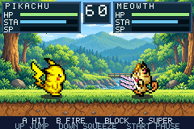

# Pokémon Battle Arena

**Pick your Pokémon. Read your rival. Earn your super.**

A native Game Boy Advance fan-made fighter by **Surenkh**.

[**Download the GBA game**](downloads/PokemonBattleArena.gba?raw=true) · [Checksum](downloads/SHA256SUMS.txt)

Version **0.3.0 — Elemental Attacks**. Open the ROM in a GBA emulator such as mGBA. On GitHub's file page, use **Download raw file** if needed. No commercial ROM or BIOS is included. A dedicated GitHub Release has not been created.

## Six fighters, six attack identities

| Fighter | Attack visuals |
| --- | --- |
| Pikachu | Crackling lightning |
| Charmander | Flames and embers |
| Squirtle | Water pulses and splashes |
| Bulbasaur | Spinning leaves and vines |
| Eevee | Glowing stars |
| Meowth | Claw waves and scratches |

Normal projectiles and supers have four-frame animations. Muzzle flashes, hit effects, and blocked-hit effects match the attacker. Movement animations, momentum, stamina, CPU opponents, and charged supers remain part of the game. Supers bypass block and can be evaded with a jump or timed squeeze.

## Controls

| GBA button | Action |
| --- | --- |
| Left / Right | Move |
| Up | Jump |
| Down | Timed squeeze dodge |
| A | Melee |
| B | Fire |
| L held | Block |
| R | Super: 100 SP and 25 stamina |
| Start | Pause |
| Select on title/selector | Controls |

Emulator key bindings depend on your setup. Clean hits earn super power; blocks and misses do not.

## Build and development

The editable GBA Studio project, C++ runtime, engine sources/notices, required source assets, tools, and tests are included. See [BUILDING.md](docs/BUILDING.md), [test evidence](docs/ELEMENTAL_ATTACKS_TEST_REPORT.md), [roadmap](docs/development/ROADMAP.md), and [Git workflow](CONTRIBUTING.md).

The v0.3.0 work is reviewed in PR #1 on `feat/elemental-attack-identity`. Keep changes in feature branches and update the ROM and checksum together after validation. Compiler binaries are not bundled. Historical browser-preview exports and unused optional artwork from the original pack are omitted; native build inputs and their provenance are retained.

## Limits and feedback

Physical GBA hardware and non-Linux rebuilding have not been tested. There is one arena, no multiplayer, campaign, save system, or background music. For bugs, include version, emulator/device, fighters, reproduction steps, and expected versus actual behavior.

## Credits

Unofficial fan project, not affiliated with or endorsed by Nintendo, Game Freak, or The Pokémon Company. Pokémon belongs to its respective owners. Preserve the artwork credits in assets/source/ and the engine and third-party license notices in engine/.
