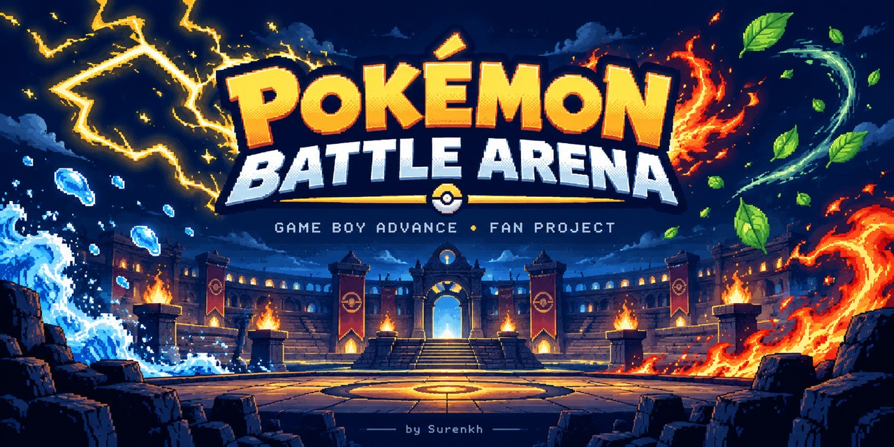
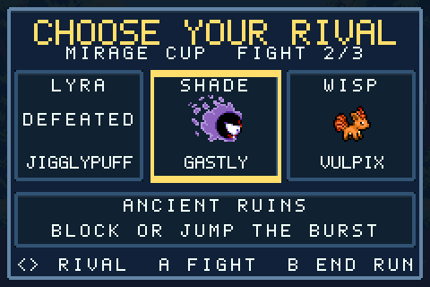

# Pokémon Battle Arena

A fan-made Game Boy Advance fighter by **Surenkh**. Pick your Pokémon, read your rival and earn your super.

**13 Pokémon** · **5 arenas** · **Solo & two-player battles**

[**Latest release and Player ZIP**](https://github.com/Surenkh/pokemon-battle-arena-gba/releases/latest) · [Download ROM](https://github.com/Surenkh/pokemon-battle-arena-gba/releases/latest/download/PokemonBattleArena.gba)

## Start playing

1. Download the **Player ZIP** from the release assets and extract it.
2. Open `PokemonBattleArena.gba` in a Game Boy Advance emulator such as [mGBA](https://mgba.io/downloads.html).
3. Press **A** or **Start**, choose **Quick Battle**, and pick your Pokémon.

Keep your emulator's save file when updating: it holds records, mastery and audio settings.

## Choose your battle

| Mode | What to play |
| --- | --- |
| **Quick Battle** | Pick a Pokémon and arena for a single fight. |
| **Arcade** | Fight five different rivals with two continues. |
| **Rival Cup** | Choose two challengers, beat a Captain and earn a saved crest. |
| **Practice** | Train follow-ups, evade supers and learn special techniques. |
| **Local Versus** | Two keyboard players choose their Pokémon and play first-to-two sets in one game window. |

  

**Local Versus setup:** Use an mGBA 0.11 development build with Lua raw keyboard input, then load the `local_versus.lua` adapter included in the ZIP. [Two-player setup and keyboard controls](docs/LOCAL_VERSUS.md).

## Fighters

Choose **Pikachu, Charmander, Squirtle, Bulbasaur, Eevee, Meowth, Psyduck, Jigglypuff, Machop, Vulpix, Gastly, Riolu** or **Totodile**. Each has distinct traits and elemental attacks.

Pikachu, Squirtle, Jigglypuff and Gastly also have special techniques and Practice lessons. [Meet the fighters](docs/FIGHTER_ROSTER.md) · [Technique guide](docs/TECHNIQUES_PLAYER_GUIDE.md)

## Battle controls

| GBA control | Action |
| --- | --- |
| Left / Right | Move |
| Up / Down | Jump / timed squeeze dodge |
| A / B | Melee / fire |
| Hold L | Block ordinary attacks |
| R | Super at 100 SP and 25 stamina |
| Hold L + tap R | Breakaway during ordinary hitstun at 60 SP |
| Start | Pause |

Clean hits build SP. Try **Practice → Breakaway** to learn when to spend it on an escape. Supers bypass blocks, so jump or time a squeeze to evade them. Down now has an animated dodge with a wind trail. Projectile clashes, battle music and finish cues add feedback during a fight. Emulator keyboard bindings can be configured in your emulator.

## More information

[Local Versus setup](docs/LOCAL_VERSUS.md) · [Rival Cup guide](docs/RIVAL_CUP_PLAYER_GUIDE.md) · [Build from source](docs/BUILDING.md) · [Roadmap](docs/development/ROADMAP.md)

Unofficial fan project; not affiliated with or endorsed by Nintendo, Game Freak or The Pokémon Company. Pokémon belongs to its respective owners. See the [artwork credits](assets/source/CREDITS.md) and [engine notices](engine/NOTICES.md).
