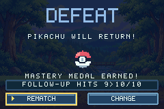
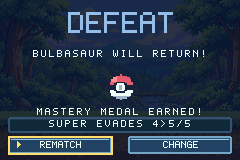
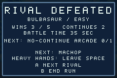
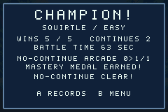

# v0.12.0 validation — Match Goals & Rival Scouting

Verified 2 November 2026 with GBA Studio 0.5.0, its bundled devkitARM 16.1.0 and
mGBA 0.10.2 on Linux x86-64. The candidate builds on the merged v0.11.0 release.
ROM: 2,323,056 bytes. SHA-256:
`cce5c5b04141538d82c36190c31e295582e9021bc600a226beff2911bd8b8ec9`.

## One relevant goal after a fight

Quick Battle, Arcade results and Champion show one mastery line. The baseline
is the selected fighter's actual progress at the start of that match. The end
snapshot is taken after normal round processing, including the final Arcade
record update. It does not grant progress, modify a save or alter CombatCore.
Defeat and draw retain earned increments, just as the existing mastery rules do.

| Situation, in priority order | Display |
| --- | --- |
| Newly earned no-continue medal | `NO-CONTINUE ARCADE 0>1/1` |
| Newly completed follow-up or evasion medal | The completed counter's actual before/after value; follow-ups win a tie |
| An intermediate technique increment | The actual before/after count; follow-ups win a tie |
| No increment | `NEXT:` and the next unfinished goal, in follow-up, evasion, then Arcade order |
| All three medals already earned | `ALL 3 MASTERY MEDALS!` |

The counter cap remains 10 follow-ups or 5 evades. No extra progress is invented
for capped counters. Results retain their initial snapshot rather than advancing
it when a screen redraws. Rematch, next rival and paid continue each capture a
new baseline. Changing fighter starts from that fighter's counters. Practice has
no mastery result, and leaving an unfinished fight creates no result summary.

The existing medal announcement remains separate. A save failure takes priority
in that notification row and explicitly says `SAVE FAILED: MEMORY ONLY`; it does
not claim the visible in-memory increment was persisted. Save boundaries and
schema 3 (two 420-byte copies) are unchanged.

## Actionable Arcade scouting

The existing rival panel names the actual next fighter after Arcade's normal
stage advance, then shows its authored trait and one short counter cue. A usable
loss or draw scouts the same rival for the retry. Champion has no sixth rival;
an exhausted loss has no cue for a fight the player cannot enter.

| Rival | Native cue |
| --- | --- |
| Pikachu | QUICK STEP: KEEP SOME SPACE |
| Charmander | EMBER PRESSURE: JUMP FIRE |
| Squirtle | SHELL CONTROL: USE SUPER |
| Bulbasaur | VINE REACH: BAIT THEN CLOSE |
| Eevee | ADAPTABLE: BLOCK FIRST A |
| Meowth | PUNISH: AVOID MISSED A |
| Psyduck | MIND PUSH: JUMP THE PULSE |
| Jigglypuff | FLOAT STEP: PUNISH LANDING |
| Machop | HEAVY HANDS: LEAVE SPACE |

These are counters to authored traits, not predictions of a private CPU plan.
They do not change opponent selection, AI, difficulty, meter or balance. The
same A/Start tap enters the next fight. No additional screen or mandatory wait
is introduced; B retains its existing return/end-run behavior. Continues, arena
rotation and the active-battle clock retain their existing rules.

## Native, host and release evidence

All thirteen native suites pass with 15,639 checks and zero missed display
frames. The new runner contributes 700 checks. It earns a real damaging
follow-up, a tenth follow-up, a fifth real CPU-super evade, and a no-continue
five-rival clear. It covers all nine actual scouting rivals, fresh Rematch
baselines, power cycling, all nine fighter result snapshots, complete sets,
paid continues, exhausted losses and unchanged one-confirm paths.

The runner compares exact native font masks in framebuffer captures for goal,
medal and scouting text, including side margins. Boundary counters use valid
schema-3 SRAM fixtures prepared offline before boot. New increments and the
Arcade clear are earned with normal buttons. No native runner writes live
gameplay memory. The goal/scouting journey peaks at 0.8135 of a frame. The
busiest tested Arcade frame is 0.99609375, below the v0.9.0 baseline of
0.99658203125. Supplemental result labels upload on separate frames after the
background and main labels: goal on frame 3, notification on 4, scouting on 5.
This spreads allocations without gating input.

All eleven host suites pass. The new goal suite has 373,567 checks, sweeping
all bounded before/after counter states and medal combinations for all fighters,
actual damaging follow-ups, fresh baselines, training exclusion, byte-unchanged
saves/combat and 900 read-only scouting runs. Existing save migration, interrupted
writes, CPU, mastery and Practice checks pass. Art/audio checks pass. All 90
native tap-response trials and the 8-frame manual / 14-frame KO Practice retry
checks still pass.

The 4,860-match balance probe exactly matches earlier character results and
replay digest 1172440822, with zero timeouts. An independent source snapshot
regenerates all assets/configuration and clean-builds a byte-identical ROM.
All nine release integrity tests and release packaging pass. Versioned ROM-bound
reports live under verification/v0.12.0/.

## Open player pilot and release decision

This iteration is a playable prototype. The roadmap made it conditional on
post-match observation that players lack a next goal. That observation and the
retention claim have not been established. Automated evidence proves the
presentation is truthful and the existing flows still work; it does not prove
that players understand the cues or choose to play longer.

1. Recruit five players and compare the released v0.11.0 build with this
   candidate. Counterbalance build order and record the order; use separate
   equivalent save states, the same difficulty and the same controller setup.
2. Allow ten minutes of free play per build without suggesting a replay or
   explaining the new lines. After the first result, ask what they would try
   next and why. Record the named goal/counter and spontaneous replay decisions.
3. Log whether each player can name a concrete next goal, whether they can
   describe an appropriate response to the displayed rival, how many voluntarily
   start another fight, and any confusion or delays caused by the panel.
4. Keep or revise the design if at least 4 of 5 can name their next goal and at
   least 3 voluntarily start another fight. If the gate fails, remove or rework
   the prototype before claiming the retention milestone is complete. Record
   baseline/candidate observations rather than inferring causality from five
   people.

The earlier uncoached navigation/Practice pilots, transfer of a learned technique
into Quick Battle, human matchup review and physical GBA/controller validation
remain open. The next roadmap phase is v1.0 validation; these are real outstanding
checks, not completed by this emulator run.
