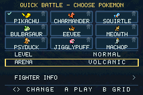
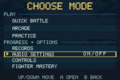

# v0.10.0 validation — Clear Navigation

Verified 2 November 2026 with pinned GBA Studio 0.5.0, bundled devkitARM 16.1.0
and mGBA 0.10.2 on Linux x86-64. The ROM is 2,322,524 bytes.

SHA-256 25e864ae8425b93fbfc13ef61728b1d079a0425d46643adfad10dc0f7e669ab6.

## Setup controls

| Context | Behavior |
| --- | --- |
| Any fighter grid | D-pad chooses a Pokémon. A/Start plays. Select jumps directly to settings for that fighter. |
| Settings | Up/Down chooses a row and Left/Right adjusts a value. Select or B returns to the same fighter card. |
| Fighter Info row | A opens the guide. B restores its exact row and chosen fighter. Start plays directly. R also remains an optional guide shortcut. |
| Quick Battle | Settings contain Level, Arena and Fighter Info. |
| Arcade | Settings contain Level and Fighter Info. The Arena value says ROTATES, and the cursor skips it in both directions. |
| Practice | Settings contain Dummy, Rival, Arena and Fighter Info. |
| Back from the grid | Returns to the originating mode row with configured values retained in this session. |

A turquoise check marks the chosen fighter through every setup row. A gold border
marks the active card or row, with a caret on menu actions. The mode menu groups
its three play destinations together. Contextual footers identify the available
action on a grid, value row or Info row. Pause, results and Audio use the same
border and caret. Rematch and Change have neutral artwork beneath the moving
result highlight.

## Arcade and confirmation

When Arcade has zero continues, Pause dims Rematch and skips it in both
directions. The final defeat screen offers A FINISH RUN. A/Start returns to the
Arcade mode row, and B also ends the run. The test verifies that a continue is
spent only after confirmation and that an exhausted run finishes immediately.

Held confirmations produce one transition. A three-input path from title to
Quick Battle remains available. One-frame presses with one-frame releases also
follow title → mode menu → fighter grid → countdown exactly once per press.

## Native acceptance

All eleven native suites pass with **14,275 checks and zero missed display
frames**. The new navigation suite contributes 263 checks using actual GBA button
inputs, read-only telemetry and native framebuffer captures.

| Journey or regression | Evidence |
| --- | --- |
| Pikachu in Volcanic after reading its guide | Direct Select, arena edit, visible Info action, exact Back context and actual battle launch as Pikachu in Volcanic |
| Machop against blocking Squirtle in Shoreline Practice | Dummy/rival/arena configuration, visible guide, Start from Info and an actual match with the requested participants |
| Every fighter in all three setup modes | 27 guide round trips, preserving the selected card and configured values |
| Shoulder-free navigation | Both tasks, all guide round trips, Audio and result/continue routes use no L/R menu inputs |
| Visible focus | Native pixel checks at both ends of the 224-pixel arena border, and exactly one gold result highlight before and after changing selection |
| Input safety | Held A/Select, rapid confirmations, and exactly one continue consumed per confirmation |
| Existing game | Nine host suites, other ten native suites, art/audio checks, saves and complete Arcade runs pass |
| Combat response | All 90 tap trials still accept on F1 and visibly respond on F2, with configured shot/super release timing |

## Performance and source

Static headings, option labels and mode names are baked into native backgrounds.
A wide focus joins two sprite halves so its outline reaches both screen margins
within GBA affine sprite bounds. The check/caret reuses one small two-frame asset.
Setup value labels begin on the second display frame, separating text allocation
from the background upload. Input and focus movement process on the first frame.

The complete navigation journey peaks at **0.7405 of a frame**. The busiest tested
Arcade frame is **0.9954**, below the v0.9.1 peak of 0.9966. No test reports a missed
frame. The 4,860-match ordered-matchup probe reproduces the earlier character
results, timings and replay digest 1172440822, with zero timeouts.

The source of truth is tools/convert_assets.cjs plus src/pkmn_app.cpp. Required
native assets and GBA Studio imports are tracked. Versioned evidence in
verification/v0.10.0/ binds every native report to this ROM hash and its runner.
An independent source snapshot regenerates the assets and clean-builds an
identical ROM using a fresh pinned dependency install. The release packager
requires all eleven native reports and verifies checksums, version consistency,
zero missed frames and the clean-build result.

The five-person uncoached navigation pilot and physical GBA/controller testing
remain open. The two product tasks above have automated native coverage. Older
setup instructions in versioned contracts describe their own releases.
