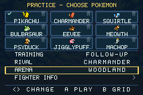
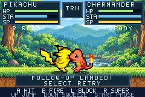
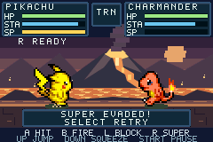

# v0.11.0 validation — Practice & Drills

Verified 2 November 2026 with GBA Studio 0.5.0, bundled devkitARM 16.1.0 and mGBA
0.10.2 on Linux x86-64. The ROM is 2,325,288 bytes.

SHA-256 c558f89f3efc88644d1803859a0605cf95d39a0fbb17fc5379517ef2a16d8072.

## Training choices

Practice's first settings row is Training. It offers Free, Block, Attack,
Follow-up and Evade Super. The initial three modes retain their existing dummy
policies. Rival, Arena and Fighter Info use the v0.10 navigation controls.

| Drill | Initial situation | Completion and coaching |
| --- | --- | --- |
| Follow-up | Both Pokémon have normal training resources and start 20 pixels apart. The rival is idle. | A resolved, damaging player B projectile marked as a follow-up completes the drill. A normal shot, block, whiff or Eevee's second A gets no completion. Feedback prompts a clean melee hit, identifies a normal shot or reports a landed B follow-up. |
| Evade Super | Normal starting distance. After 45 simulation ticks, an eligible rival sends one ordinary R request. It spends its actual SP and stamina. | The complete super must pass beyond the player after a nearby jump or active squeeze. Feedback shows the charge, asks for the dodge and reports an evade, actual hit or interrupted charge. |

The evasion observer in include/pkmn_super_evasion.h is shared with mastery. It
accepts a const CombatCore, tracks a shot identity, proximity and full passage,
and emits success once. A hit or invulnerability contact consumes the projectile
first. Practice's coaching reads resolved events and never changes the simulated
result. Its prepare method sets training resources/positions before play and
returns immediately for a regular combat core.

Practice remains excluded from all mastery counters. Drill completion lives in
session memory. Both lessons work with all nine fighters and all three arenas.
The learner can reset any attempt with Select and open Pause with Start.

## Retry timing

F1 is the completed emulator frame that samples Select or resolves the KO.
The measurement ends on the frame where a fresh A actually enters melee.
Controller transport, host display latency and human recognition need separate
measurements.

| Route | Measured first legal action | Evidence |
| --- | ---: | --- |
| Manual Practice reset | F8 | All 46 trials across every training type and all nine fighters |
| Automatic Practice KO restart | F14 | Actual KO, six-frame result hold and six-frame Ready |
| Earlier manual reset | F182 | Published v0.9.0 measurement recorded in the input audit |

Manual reset clears statistics, completion, projectiles and pending actions. It
restores HP, stamina, full training SP and the chosen starting positions.
Automatic restart restores the same resources and retains damage/chain
statistics. Both keep the fighter, rival, arena and training type.

A six-frame Ready state clears both fighters' pending inputs. Taps made during
Ready and buttons held through it cannot emerge as queued attacks. The native
runner tests Select with B, a fresh A during Ready, held A afterward and a new
press after releasing it. Regular match countdowns are 180 display frames,
normal loss recalls are 156, and the pause resume countdown is 60.

## Native and host checks

All **12 native suites pass with 14,939 checks and zero missed display frames**.
The Practice suite contributes 664 checks. It completes a B follow-up and both
jump/squeeze evasions for all nine fighters, uses every arena, pauses during a
real charge, verifies mastery exclusion and measures retries in all five modes.
It also checks actual super-hit feedback, a real automatic KO restart, retained
statistics and return to ordinary earned-meter rules.

All **10 host suites pass**. The new Practice suite has 37,206 checks covering
resolved goals, blocked/ordinary shots, Eevee A-to-A exclusion, interrupted
supers, resource rejection, observer deduplication and combat-checksum isolation.
Existing save/migration, roster, CPU, presentation, input-buffer and mastery
suites also pass. The Practice host checks also cover a finishing B follow-up after KO cleanup and
an Eevee A-to-A KO that must not complete the B lesson. The presentation suite
checks the short training hold alongside
normal recalls and draws.

All art/audio checks pass. The 4,860-match balance probe reproduces the earlier
character results, timings and replay digest 1172440822, with zero timeouts.
The 90 native tap-response trials also pass. The complete Practice journey peaks
at 0.8328 of a frame; the busiest tested Arcade frame is 0.9951.

Versioned evidence lives in verification/v0.11.0/. Each native report carries the
ROM hash, runner path and runner hash. An independent source snapshot regenerates
the assets/configuration and clean-builds an identical ROM using fresh pinned
npm dependencies. Release packaging requires all twelve native reports, zero
missed frames, matching checksums and the clean-build result.

The five-learner pilot and transfer of a learned technique into Quick Battle
remain open. Physical GBA/controller testing also remains open.
