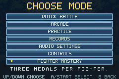

# v0.9.1 validation — Responsive Firing

Verified 2 November 2026 with GBA Studio 0.5.0, bundled devkitARM 16.1.0 and mGBA
0.10.2 on Linux x86-64. The ROM is 2,283,244 bytes.

SHA-256 `7a3fe1a3b83c5c83f2d6fca169b9cc7958a1150a125bb4441aae762a1d180f01`.

## Firing cues

Pikachu, Squirtle, Meowth, Psyduck and Machop begin a normal shot with their
existing authored Charge clip. On the shot's release step, the renderer uses the
original Shoot impact frame and continues its recovery animation. The asset
preparer detects an idle-identical first Shoot cell, records the selected windup
in the manifest and emits the renderer's table. The asset test verifies that each
first windup tile differs from every idle tile for that fighter. All 611 source
frames and their original indices remain available.

The presentation reads the accepted FIRE action. An unaffordable or blocked
request has the existing rejection behavior. The action is visible to the CPU as
FIRE throughout its startup. The gameplay core, input buffer and fighter/CPU
configuration have the same source as the released v0.9.0 build.

## Measured response

F1 is the first completed emulator frame after setting the button. F2 is the next
frame. The test compares pixels around the player against the same frame in a
matched no-input replay. Button transport, host display latency and a person's
recognition of the cue require separate tests.

| Fighter | v0.9.0 B cue across four idle phases | v0.9.1 B cue across the same phases | Shot release frame |
| --- | --- | --- | --- |
| Pikachu | 10, 10, 10, 6 | 2, 2, 2, 2 | 9 |
| Charmander | 2, 2, 2, 2 | 2, 2, 2, 2 | 11 |
| Squirtle | 7, 6, 2, 2 | 2, 2, 2, 2 | 11 |
| Bulbasaur | 2, 2, 2, 2 | 2, 2, 2, 2 | 12 |
| Eevee | 2, 2, 2, 2 | 2, 2, 2, 2 | 9 |
| Meowth | 10, 10, 6, 2 | 2, 2, 2, 2 | 9 |
| Psyduck | 7, 7, 6, 2 | 2, 2, 2, 2 | 11 |
| Jigglypuff | 2, 2, 2, 2 | 2, 2, 2, 2 | 10 |
| Machop | 14, 14, 10, 6 | 2, 2, 2, 2 | 13 |

All 90 tap trials enter their action on F1 and visibly respond on F2. The trial
set includes all nine fighters with A, B, Up, Down, L, R and Right, plus three
additional idle phases for B. The suite verifies every shot and super release
against the configured startup tick. It also verifies all nine fighters with
held B, an occupied projectile slot and insufficient stamina. A rejected shot
never receives the firing cue. The existing host and native suites cover
recovery buffering, follow-ups, hitstop, landing, pause/resume and both fighters.
The earlier measurement procedure remains in the [v0.9.0 audit](development/INPUT_AND_NAVIGATION_BASELINE.md).

## Menu correction

The Mastery description now reads “THREE MEDALS PER FIGHTER.” All seven runtime
menu descriptions pass the eight-pixel side-margin check at 240 × 160. The README
and packaged controls list Fighter, Dummy, Rival and Arena for Practice setup.
The new menu capture comes from the tested ROM.

## Regression and reproducibility

All ten native suites pass with **14,042 checks and zero missed display frames**.
The response suite contributes 707 checks, 90 measured trials and a peak CPU
fraction of 0.6853. The busiest Arcade transition remains 0.9966 of a frame.

All nine host suites and all animation, effects and audio asset checks pass.
The 4,860-round ordered-matchup probe produces the same timings, character
results and replay digest, 1172440822, as v0.9.0. It reports zero timeouts.

An independent source snapshot installs the pinned npm packages, regenerates
graphics, UI, animation metadata, audio and combat configuration, then clean
builds a byte-identical ROM. Versioned evidence in verification/v0.9.1/ binds each
native report to the ROM hash and runner source. Release packaging verifies that
hash, the checksums, zero missed frames and the clean-build result.

Visual inspection covered the Pikachu and Machop cues at native resolution and
the corrected Mastery menu text. The roadmap's five-person cue-recognition pilot
and physical-device latency measurement remain open. The existing nine-fighter
roster, three arenas, Arcade records and schema-3 mastery saves are covered by
the native regressions.
