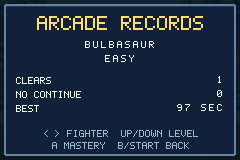

# v1.0.0-rc.1 validation — Release Candidate 1

Verified 3 November 2026 with GBA Studio 0.5.0, bundled devkitARM 16.1.0 and
mGBA 0.10.2 on Linux x86-64. This candidate builds on the merged v0.12.0 release
and GitHub GIF update. ROM: 2,335,424 bytes. SHA-256:
`a3578d3fddb10b07a54034c8ec00fa864036bbeb4dd4232497677dafa0626790`.

## Measured performance work

The prior full Arcade-suite peak was 4080/4096 of a display frame, or
99.609375%. A read-only per-frame trace located it on **Records (screen 14)**
while changing fighter, rather than a new fight's countdown. That screen
reallocated its heading, instructions, labels and values on each choice.

RC1 gives Records a dedicated background containing its fixed text. Browsing
redraws only the selected fighter, difficulty and three right-aligned values.
The maximum six-digit counter and maximum saved 32-bit time fit at x=224 without
crossing the side margin. The same one-frame direction tap changes selection;
Mastery links retain the fighter and difficulty. Save layout and progression
rules do not change.

| Measurement | v0.12.0 | RC1 |
| --- | ---: | ---: |
| Same complete Arcade regression journey | 99.609375% peak | 86.4013671875% peak |
| Records/Mastery/audio stress journey | New gate | 75.7080078125% peak |
| Records redraws within that stress journey | New gate | 41.50390625% peak |
| Missed display frames | 0 | 0 |

The two journey measurements are separate tests. The stress test checks all 27
entries twice, with audio on and off, maximum bounded values, an empty record,
180 rapid taps, exact native value glyph masks, Mastery round trips and an actual
audio-save/SRAM power cycle. It contributes 915 checks and enforces a 90% frame
budget for its journey. The before/after Arcade trace and its ROM/source hashes
are recorded in verification/v1.0.0-rc.1/performance-comparison.json.

## Automated release regression

All **14 native suites pass with 16,554 checks and zero missed display
frames**. This includes the 90 tap-response trials, all fighter/arena navigation
and Practice drills, 8-frame manual and 14-frame KO Practice retries, actual
mastery increments, all nine scouting cues, five-rival Arcade, legacy SRAM
migration, corruption fallback and power-cycle retention. The maximum-value
Records fixture is prepared offline before boot; all navigation, audio changes
and saves then use actual GBA controls. No native runner writes live game state.

All **11 host suites pass**, covering combat, movement/animation, feedback/input
buffering, fighter depth, CPU tactics, recall, Arcade/saves, roster traits,
mastery, Practice and match goals. The save suites retain bit-corruption and
interrupted-write coverage. All art/audio checks pass. The 4,860-match probe
exactly matches prior fighter results and replay digest 1172440822, with zero
timeouts. Combat configuration and simulation code are unchanged.

An independent 1,857-file source snapshot installs the pinned npm
dependencies, regenerates all graphics/UI/animation/audio/configuration inputs
and clean-builds a byte-identical ROM. All **10 release integrity tests** and
release packaging pass. Evidence is ROM-bound under verification/v1.0.0-rc.1/.

## Candidate distribution and remaining gates

Package version/tag is `1.0.0-rc.1` / `v1.0.0-rc.1`, and the native title says
`V1.0 RC1`. On the repository's existing publication path, it is a GitHub
prerelease with `make_latest=false`. The publisher regression verifies this and
its read-only rerun behavior. Latest-stable links continue to point at v0.12.0;
README candidate links identify RC1 explicitly. Publication uses the tested ROM
and verified checksums, rather than rebuilding a different ROM in CI.

This is an automated release candidate, not a claim that the final v1.0 gates
have passed. The uncoached navigation/Practice pilots, transfer into Quick
Battle, next-goal/replay pilot, human matchup review and physical GBA/controller
sessions remain open. [The release checklist](V1_RELEASE_CHECKLIST.md) gives the
concrete tasks, pass criteria and final release decision. Emulator frame-budget
measurements do not include physical controller or display latency.
