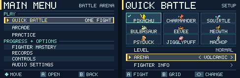

# Pokémon Battle Arena product roadmap

**Design baseline · 2 November 2026 · Released game v0.9.0**

v0.9.1 is implemented and merged. The **v0.10.0 candidate** now provides direct
settings access, retained fighter selection, a visible Info action and consistent
focus/Back controls. Both product setup tasks and all 27 guide round trips pass
native automation. The five-person navigation pilot remains open.
[Candidate validation](../NAVIGATION_TEST_REPORT.md)

## What the current game tells us

| Player experience | Finding in v0.9.0 | Product decision |
| --- | --- | --- |
| Tapping an attack | All 63 neutral one-frame taps changed simulation state on the first emulator frame tested. A melee tap changed fighter-area pixels on frame 2 for all nine. For B, the first difference from an idle replay ranged from frame 2 to 14. Five fighters start their firing animation in a pose shared with idle. | Give those fighters a distinct first windup pose. Preserve the time an opponent has to read and defend against the shot. |
| Choosing a fight | The seven modes and nine fighters are visible. From Pikachu, four Down taps reach Arena through Bulbasaur and Psyduck. Pressing Play there starts as Psyduck. Select means Info in Quick Battle and cycles options in Practice. | Give every fighter a direct route to settings, one navigation convention across modes and a visible marker for the fighter who will play. |
| Learning a technique | Practice has three dummy behaviors, full starting super power, damage feedback and a fighter guide. Resetting it replayed the countdown. The first legal melee input in our reset trace came on frame 182. | Shorten the time between attempts and teach two useful skills in the arena where players perform them. |
| Coming back after a match | Arcade already offers five rivals, two continues and three arenas. There are 27 fighter/difficulty records and three medals per fighter. The result announces a newly earned medal, but routine progress is on a separate screen. | Test whether one personal goal or one rival cue gives a player a reason to try again. |
| Shipping on GBA | The release passed nine native suites with zero missed frames. The heaviest measured Arcade frame used 99.66% of its budget. Human matchup balance and physical-device response are still open. | Use existing tiles and short static labels. Profile busy transitions and start recruiting device testers during the first iteration. |

The timings above come from the published ROM in mGBA. The audit includes frame definitions, all nine fighter results, recovery boundaries and the exact menu route. [Input and navigation audit](INPUT_AND_NAVIGATION_BASELINE.md) · [Released v0.9.0](https://github.com/Surenkh/pokemon-battle-arena-gba/releases/tag/v0.9.0) · [Release validation](../ARENAS_AND_MASTERY_TEST_REPORT.md)

## Release sequence

Each row ends in a build someone can play. The effort ranges are provisional hands-on development days assuming one gameplay engineer with part-time pixel art and test support. Recruitment, device access and review add calendar time. Re-estimate after the first two-fighter build.

| Order | Playable iteration | Why it comes here | Release decision |
| --- | --- | --- | --- |
| 1 · v0.9.1 · implemented | Immediate firing cues, starting with Machop and Pikachu. Repair the clipped Mastery description and list Arena in the Practice controls. | There is a measured, visible delay and a small visual repair that can ship independently. | Every fighter's eligible B tap visibly starts by frame 2 in all four replay phases. The projectile still spawns on its original tick. |
| 2 · v0.10.0 · candidate | Consistent focus, direct access to setup options, contextual button labels and predictable Back behavior. | Changing the stage currently changes the selected fighter along a natural route. This affects the choice made before combat. | From Pikachu, set Volcanic and fight as Pikachu with no roster traversal. At least 4 of 5 pilot players independently configure both requested setups. |
| 3 · v0.11.0 · 5–8 days | Fast Practice retry and two optional drills inside Practice. | Once controls and navigation are readable, players can learn what earns a follow-up or evades a super. | Practice accepts a fresh action within 15 display frames of reset. At least 4 of 5 learners perform both techniques against the dummy without verbal coaching. |
| 4 · v0.12.0 · 3–6 days, conditional | Show a relevant mastery increment after a fight and a short scouting cue for the next Arcade rival. | The existing records, traits and medals can make a return match purposeful with little new content. | Prototype only if post-match observation shows players lack a next goal. Keep the feature if 4 of 5 can name their next goal and at least 3 voluntarily start another fight in the pilot. |
| 5 · v1.0 candidate · 3–5 days plus device sessions | Human matchup review, hardware checks, save migration and release regression. | The nine-fighter roster needs to hold up across devices and skill levels before a stable launch. | Reproduce the input and menu gates, complete representative real-device runs, and resolve reproducible control, progression or performance blockers. |

## First iteration backlog

| In build order | Owner | Work and evidence |
| --- | --- | --- |
| 1. Establish the comparison | QA + gameplay | Replay a one-frame tap and a matched no-input run on the released ROM. Record the sampled button, first accepted action, first changed fighter pixels and shot release as separate events. Capture the player's device, emulator, controller and representative move when available. |
| 2. Make two moves readable | Pixel art + gameplay | For Machop, plant the feet and draw the fist back. For Pikachu, lower the body and show the cheek charge. Try an existing distinct animation tile first. Show the cue on entering FIRE, so a rejected B never looks like a cast. Keep the muzzle effect for release. |
| 3. Check what players see | Design + QA | Interleave muted baseline and candidate clips in counterbalanced order. Ask five players when the move begins and when it can hit. Advance if at least four identify the start before the projectile on both candidates. Rework the silhouette if the pixel test passes and players still miss the cue. |
| 4. Extend and verify | Gameplay + QA | Fix the remaining affected starts for Squirtle, Meowth and Psyduck. Sweep all nine fighters, held and repeated taps, hitstop, low stamina, an occupied shot slot, landing, recovery and pause/resume. Compare the same seeded fights for projectile ticks, damage, meter and outcomes. Run the native suites and check missed frames. |

The current buffer gives an eligible press three simulation attempts. In a Pikachu whiff test, B two ticks before recovery ended fired on the first legal tick. Three ticks early expired. Keep that rule for the first build. If players still report lost taps, capture the exact state and test a **four-tick recovery window** against three in a separate rules prototype. Count saved intended inputs *and* unwanted late attacks. Adopt it only if recovery improves without extra attacks, guard escapes, double spends or input carried across pause. Device-only delay goes to a filmed button-to-display comparison on the reported setup. [Buffer contract](../COMBAT_FEEL.md) · [Combat core](../../src/pkmn_combat_core.cpp)

## Navigation design for v0.10.0

*Proposed screens at native size.* A check marks the fighter who will play. A full-width border and caret mark the row receiving the next input. Each screen has one contextual legend. Keep all seven destinations on one menu, with the three play modes together. Use the same focus treatment for Pause, audio and results. Give Change the sole active outline when it is selected on results. The released result artwork already has a highlighted Rematch button baked into the background. [Current mode menu](../media/mode-menu-native.png) · [Current selector](../media/nine-fighter-selector-native.png) · [UI source](../../tools/convert_assets.cjs)

| Context | Proposed behavior |
| --- | --- |
| Fighter grid in Quick, Arcade or Practice | D-pad browses fighters. A/Start plays the highlighted fighter immediately. Select jumps directly to settings for that fighter. The footer says “Select Options.” |
| Settings | Up/Down moves rows and Left/Right changes a value. A/Start plays from a value row. A on the visibly labeled Fighter Info row opens the guide. Start remains the fast path to play. Arcade's rotating arena appears as information and the cursor skips it. |
| Returning | B from Info returns to the row that opened it. B from settings restores focus to the chosen fighter. B from the grid returns to the originating mode. Keep settings and fighter selection during the trip. |
| Results and unavailable choices | Show one active choice, a verb on each button, and the remaining continue cost where relevant. With zero continues, give Arcade players a visible way to finish the run. One confirm tap produces one transition. |

Build Quick Battle first and compare it with the released grid at 240 × 160. Then apply the same components to Practice, Arcade, Pause and results. Bake static headings and icons into the background and move one dynamic focus marker. Update the in-game legend and README together. Check the longest label, Jigglypuff, all arena names, disabled rows and sound-off play. Target an eight-pixel side margin for labels. Test both new and returning players, including whether they find the relocated Fighter Info action. Add D-pad hold-repeat only if repeated navigation taps are a demonstrated problem.

The two uncoached tasks are **“Start as Pikachu in Volcanic after reading its guide”** and **“Set up Machop against a blocking Squirtle in Shoreline Practice.”** Log elapsed time, wrong-fighter launches, backtracks and requests for help. The proposed gate includes zero wrong-fighter launches or double activations in the five-player pilot. A shortcut-only player should retain the current three-input path from title to Quick Battle countdown.

## What to build after navigation

**Practice.** Start with one repeatable clean melee into B against an idle rival. Then give the rival one visible super and let the player jump or squeeze through it. Show one short explanation per attempt, such as “Blocked” or “Pressed before the opening,” only when the combat events support it. Retry in place, clear stale presses and restore the drill position and resources. Free Practice stays available and medal progress belongs to regular fights. After the two drills, ask players to attempt one technique in Quick Battle. Record how many can transfer what they learned. [Practice implementation](../../include/pkmn_practice.h) · [Fighter depth](../FIGHTER_DEPTH.md)

**Arcade and mastery.** Put one line on the existing results panel, for example “Pikachu follow-ups 6 → 7 / 10.” On the existing next-rival panel, try one actionable hint, for example “Machop drains guard stamina. Leave room to retreat.” Use the selected fighter's actual session delta and the next rival's authored trait. Give Rematch or Next Rival the same input count as today. Observe a fixed ten-minute free-play period on each build and record replays and players' reasons. A small pilot can select a design for further testing. [Existing progression rules](../ARENAS_AND_MASTERY.md) · [Nine fighter traits](../NINE_FIGHTERS.md)

**Stable release.** Start with rushdown against guard pressure, ranged pushback and a floaty jump against long reach. Have human players swap sides and report whether they recognized what beat them and could try a counter. Use the 81 ordered CPU matchups to catch regressions. Test legacy SRAM, power-cycle records and mastery, and rehearse a five-rival run on a physical GBA. Require zero missed frames on the native suite and no increase over the v0.9.0 busiest Arcade transition. Profile new menu work toward 90% of a frame or less. Delay additional visuals if that budget slips. [Native testing](../NATIVE_TESTING.md) · [Save compatibility](../ARENAS_AND_MASTERY.md)

**Scope decision.** Revisit a tenth fighter or fourth arena when returning players can use the current roster and ask for new matchups. Mid-run saving becomes a candidate if interrupted runs are a recurring reason people leave Arcade. Link multiplayer needs its own hardware feasibility study. The first two releases above address problems already visible in the shipped game.

## Where the earlier roadmap landed

| Original direction | Shipped evidence |
| --- | --- |
| Character identity and elemental attacks · v0.3 | [Iteration design](ITERATION_01_ELEMENTAL_ATTACKS.md) and [elemental attack validation](../ELEMENTAL_ATTACKS_TEST_REPORT.md) |
| Impact and responsive combat · v0.4 | [Combat feel](../COMBAT_FEEL.md) and [validation](../COMBAT_FEEL_TEST_REPORT.md) |
| Deeper fighter decisions and Practice · v0.5 | [Fighter depth](../FIGHTER_DEPTH.md) and [validation](../FIGHTER_DEPTH_TEST_REPORT.md) |
| Smarter opponents · v0.6 | [CPU tactics](../CPU_TACTICS.md) and [validation](../CPU_TACTICS_TEST_REPORT.md) |
| Audio, recall, arena life and replay · v0.7–v0.8 | [Audio and recall](../AUDIO_AND_RECALL.md), [Arcade and records](../ARCADE_AND_RECORDS.md) and [nine-fighter expansion](../NINE_FIGHTERS.md) |
| Arenas and fighter mastery · v0.9 | [Implementation contract](../ARENAS_AND_MASTERY.md) and [release evidence](../ARENAS_AND_MASTERY_TEST_REPORT.md) |
